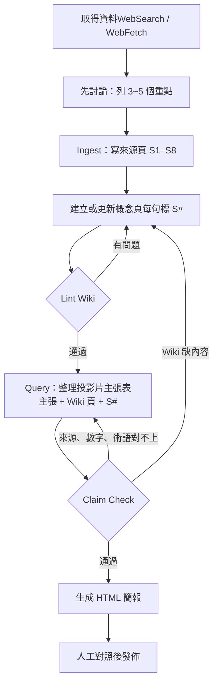

LLM WIKI 作業繳交

# AI Agents Wiki

主題「AI Agents 是什麼？」：13 個概念頁、8 篇來源，每個事實句標註來源編號，再用這份 Wiki 製作教學簡報。

## 繳交說明

### 1. LLM Wiki 主題與簡短介紹

主題是 AI Agents。Wiki 採用 Karpathy 的 LLM Wiki 三層架構：raw sources（來源）、wiki（概念頁與來源頁）、schema（規則檔）。概念頁共 13 頁（定義、組成、ReAct、Reflexion、MCP、限制等），來源頁共 8 篇（S1–S8），概念頁的每個事實句結尾都標註 [S1](#s-s1) 這樣的來源編號。

### 2. LLM Wiki 成果

左側目錄可以瀏覽全部頁面：[index.md](#wiki-index)、[SCHEMA.md](#wiki-schema)、[log.md](#wiki-log)、13 個概念頁與 8 個來源頁。

### 3. 教學 HTML 簡報

簡報共 14 張：[AI Agents 是什麼（簡報連結）](https://claude.ai/artifact/2BsD8RmQUJBCxYXLqohweq)。每張底部標示使用的 Wiki 頁面與來源，講者備註裡有逐點對應。簡報預設為私人，需要在 Share 選單分享後，別人才打得開。

### 4. loop / graph 設計

**哪些步驟會重複：**Lint 與 Claim Check 各自形成一個迴圈，沒通過就回頭修，直到通過才往下走。

**哪些地方檢查或重新生成：**寫完概念頁後跑 Lint（來源編號存在、連結有效、沒有孤兒頁、單一來源要標註）；生成簡報前先跑 Claim Check（每個主張的來源編號、數字、英文術語都必須出現在指定的 Wiki 頁面）。

**為什麼這樣設計：**簡報只能使用 Wiki 裡的句子，所以錯誤要在 Wiki 階段和「主張表」階段攔下，而不是等簡報做完再改。主張表是純文字，檢查和重做的成本都很低。

### 5. 一次實際執行的檢查紀錄

| 步驟 | 做了什麼 | 結果 |
| --- | --- | --- |
| 取得資料 | 6 個搜尋，另用 WebFetch 讀 S1、S6、S2 | 8 篇可用；S3、S4、S5、S7、S8 只有搜尋摘要，未讀全文 |
| Ingest | 寫 S1–S8 來源頁 | S5 的兩份資料對 MCP resources、prompts 的控制歸屬說法不同，記為分歧，簡報不使用這一點 |
| 建概念頁 | 13 頁，每句標 S# | 完成 |
| Lint #1 | 檢查腳本 | FAIL 3 頁只有單一來源、1 個孤兒頁 |
| 修正 | 單一來源頁加註明，memory 頁補連結，Lint 規則允許明確標註單一來源 | Lint #2 OK |
| Claim Check #1 | 13 張、39 個主張對照 Wiki | OK |
| 人工對照 | 逐張看簡報主張與 Wiki 頁 | 發現缺口 第 12 頁「三原則」在指定的 Wiki 頁沒有對應句，只在來源頁 |
| 修正 | 補 Wiki 一句、改主張表、Claim Check 加「英文術語必須在 Wiki 頁出現」 | Lint 與 Claim Check #2 OK |
| 生成與發佈 | 14 張簡報（13 張內容 + 來源頁） | 完成 |

完整操作紀錄見 [log.md](#wiki-log)。

### 6. 反思

**最常出錯的節點是「建立概念頁」。**Lint 一抓就出現 4 個問題（單一來源、孤兒頁），簡報階段發現的缺口也是因為 Wiki 頁沒有寫到那句話。

**檢查往前移了：**原本打算做完簡報再對照，後來改成先產生「主張表」，在生成簡報之前就用腳本檢查。Claim Check 發現 Wiki 缺內容時，現在可以直接回到「建立概念頁」補，而不是在簡報裡硬寫。

**有修改 graph：**新增了 Claim Check 到概念頁的回頭路徑，並放寬 Lint 規則，讓明確標註的單一來源頁可以通過。原因是 Claim Check #1 通過了，我人工對照仍發現缺口：它只檢查來源標籤，抓不到中文語意，所以才加了英文術語規則。

**目前的限制：**Claim Check 不能判斷中文句子有沒有被誤改；簡報裡的卡片文字和流程圖標籤也沒有納入主張表；5 篇來源只讀到摘要層級。這些是下一輪要補的地方。